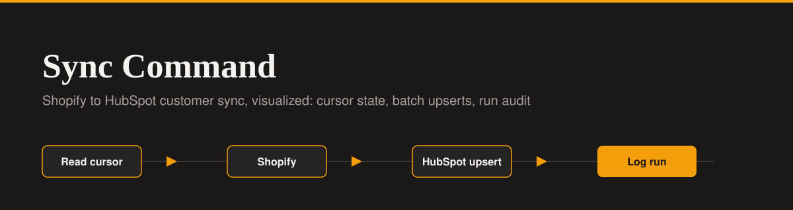

<div align="center">




</div>

# Sync Command - Shopify to HubSpot Customer Sync

A premium B2B observability dashboard that acts as the UI layer for an n8n data pipeline. This app visualizes the logic of **Workflow 3 (Shopify to HubSpot Customer Sync)** by simulating cursor-based pagination, batch upserts, and sync run auditing.

**Live Demo:** [getsync-command.lovable.app](https://getsync-command.lovable.app)

## n8n Workflow Reference

This UI is designed to accompany a self-hosted n8n automation. You can view the actual backend workflow code and documentation in my platform integration portfolio:

- **Repository:** [platform-integration-portfolio](https://github.com/Xhenzouu/platform-integration-portfolio)
- **Workflow Documentation:** [Workflow 3: Shopify to HubSpot Customer Sync](https://github.com/Xhenzouu/platform-integration-portfolio/blob/main/docs/workflows/03-shopify-to-hubspot-customer-sync.md)
- **Raw Workflow JSON:** [shopify-to-hubspot-customer-sync.json](https://github.com/Xhenzouu/platform-integration-portfolio/blob/main/workflows/shopify-to-hubspot-customer-sync.json)

The n8n workflow handles the following logic:

1. Reads the sync cursor (last successful customer update timestamp) from Supabase.
2. Fetches customers from Shopify via GraphQL, breaking pagination when the cursor is reached.
3. Maps customer fields and filters out contacts with no email address.
4. Upserts the contacts into HubSpot in batches (using string values for custom number properties).
5. Logs the run to Supabase and advances the cursor only upon full success.

This dashboard visualizes that exact flow: the top widget shows the active cursor state, and the data table tracks the history of sync runs, including the no-op and failure states.

## Features

- **Dual Themes:** Full Light and Dark mode support with a toggle switch.
- **Cursor State Widget:** Displays the exact `last_updated_at` high-water mark currently stored in the database.
- **Sync Run Table:** A data table detailing every run, including fetched counts, upserted counts, and skipped records.
- **Error Handling:** A right-side drawer that visualizes the exact `NodeApiError` payload when a sync fails.
- **API JSON Preview:** Shows the precise payload sent to HubSpot, demonstrating the string-conversion requirement for number properties.
- **Premium UI:** Strict flat design, clean typography, and no gradients.

## Tech Stack

<div align="center">


</div>

- **Frontend:** React, TypeScript, Tailwind CSS
- **Animations:** Framer Motion
- **Icons:** Lucide React

## Run Locally

1. Clone the repo:

   ```bash
   git clone https://github.com/Xhenzouu/getsync-command.git
   cd getsync-command
   ```

2. Install dependencies:

   ```bash
   npm install
   ```

3. Start the development server:

   ```bash
   npm run dev
   ```
